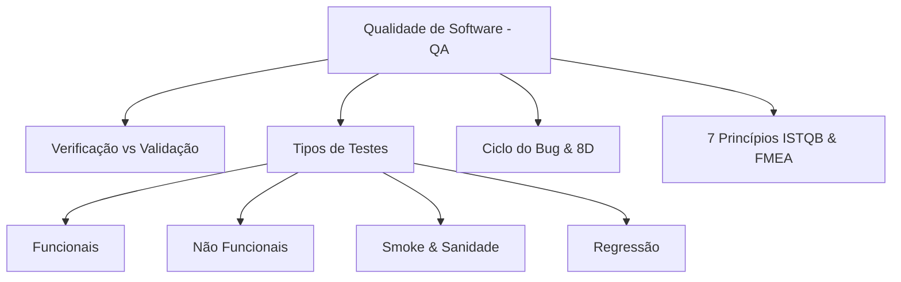

# 📝 Caderno de Anotações — Semana 01

> **Instruções de Reutilização:**  
> Este arquivo serve como diário de estudos da **Semana 01** e também como modelo para as próximas semanas.  
> Para criar os diários das semanas seguintes:
> 1. Copie este arquivo dentro da pasta `anotacoes/`.
> 2. Renomeie a cópia para `semana-02.md`, `semana-03.md` ou `semana-04.md`.
> 3. Ajuste as datas, temas dos dias e metas conforme o [`cronograma.md`](../cronograma.md).

---

## 📋 Informações da Semana
- **Período:** `[Data Inicial]` a `[Data Final]`
- **Tema:** Fundamentos de Teste & Ciclo de Vida de Software
- **Foco Central:** Construir a base conceitual e compreender a diferença entre validação, verificação e ciclo de defeitos.
- **Ritmo Diário:** 1 hora por dia (20 min teoria + 30 min prática + 10 min registro).
- **Status Geral:** 🟡 Em andamento <!-- 🟢 Concluído | 🟡 Em andamento | 🔴 Atrasado -->

---

## 📅 Registro Diário

### Dia 01 — Introdução ao QA: Validação vs. Verificação
- **Meta do Dia:** Entender a diferença essencial entre "construir o produto certo" e "construir o produto corretamente".
- **Tempo dedicado:** [ ] 1 hora (20m teoria / 30m prática / 10m anotações)
- **Status:** [ ] Concluído

#### 🧠 O que aprendi hoje (Resumo Teórico)
- *Anotações sobre verificação (conformidade com especificações técnicas e requisitos)...*
- *Anotações sobre validação (adequação ao propósito do usuário final e regras de negócio)...*
- *Analogia com a Indústria Automotiva / PPAP:*

#### 💻 Prática Realizada & Exercícios
- *Descreva a atividade ou exemplos que você analisou hoje.*

#### ❓ Dificuldades & Dúvidas a Aprofundar
- *O que não ficou 100% claro?*

#### 🔗 Links e Materiais Consultados
- 

---

### Dia 02 — Tipos de Teste I: Funcionais, Exploratórios e Usabilidade
- **Meta do Dia:** Compreender a aplicação, objetivos e momentos de uso de testes funcionais, exploratórios e de usabilidade.
- **Tempo dedicado:** [ ] 1 hora
- **Status:** [ ] Concluído

#### 🧠 O que aprendi hoje (Resumo Teórico)
- *Testes Funcionais:*
- *Testes Exploratórios (charters, timeboxing):*
- *Testes de Usabilidade:*

#### 💻 Prática Realizada & Exercícios
- *Exemplo de teste exploratório realizado em uma aplicação web pública:*

#### ❓ Dificuldades & Dúvidas a Aprofundar
- 

#### 🔗 Links e Materiais Consultados
- 

---

### Dia 03 — Tipos de Teste II: Regressão, Sanidade e Smoke Tests
- **Meta do Dia:** Entender como priorizar e estruturar suítes de testes rápidas e profundas no fluxo de entregas contínuas.
- **Tempo dedicado:** [ ] 1 hora
- **Status:** [ ] Concluído

#### 🧠 O que aprendi hoje (Resumo Teórico)
- *Smoke Tests (Build Verification Test / Inspeção de partida):*
- *Sanity Tests:*
- *Regression Tests (Garantir que novos códigos não quebraram funcionalidades anteriores):*

#### 💻 Prática Realizada & Exercícios
- *Critérios definidos para escolher o que entra em um Smoke Test:*

#### ❓ Dificuldades & Dúvidas a Aprofundar
- 

#### 🔗 Links e Materiais Consultados
- 

---

### Dia 04 — Ciclo de Vida do Bug
- **Meta do Dia:** Compreender os estados de uma falha (*Novo*, *Aberto*, *Em Correção*, *Re-teste*, *Fechado*, *Reaberto*) e conectar com a contenção do método 8D.
- **Tempo dedicado:** [ ] 1 hora
- **Status:** [ ] Concluído

#### 🧠 O que aprendi hoje (Resumo Teórico)
- *Fluxograma do ciclo de vida:*
- *Analogia com a metodologia 8D (Contenção imediata D3 vs Causa raiz D4):*

#### 💻 Prática Realizada & Exercícios
- *Simulação do fluxo de transição de um bug no papel ou ferramenta:*

#### ❓ Dificuldades & Dúvidas a Aprofundar
- 

#### 🔗 Links e Materiais Consultados
- 

---

### Dia 05 — Princípios de Teste de Software
- **Meta do Dia:** Dominar os 7 Princípios de Teste do ISTQB e contextualizá-los com situações reais de desenvolvimento e prevenção de riscos (FMEA).
- **Tempo dedicado:** [ ] 1 hora
- **Status:** [ ] Concluído

#### 🧠 O que aprendi hoje (Resumo Teórico)
1. O teste demonstra a presença de defeitos, não a sua ausência.
2. O teste exaustivo é impossível.
3. Teste antecipado (*Early testing / Prevenção FMEA*).
4. Agrupamento de defeitos (*Defect clustering*).
5. Paradoxo do pesticida (*Pesticide paradox*).
6. O teste depende do contexto.
7. A ilusão da ausência de erros.

#### 💻 Prática Realizada & Exemplos
- *Exemplo real para cada um dos 7 princípios:*

#### ❓ Dificuldades & Dúvidas a Aprofundar
- 

#### 🔗 Links e Materiais Consultados
- 

---

### Dia 06 — Síntese & Exercícios Práticos
- **Meta do Dia:** Construir um mapa mental consolidando todos os conceitos e tipos de testes estudados na semana.
- **Tempo dedicado:** [ ] 1 hora
- **Status:** [ ] Concluído

#### 🧠 Síntese da Semana
- *Resumo das conexões entre os conceitos:*

#### 💻 Mapa Mental Gerado
- *Link da ferramenta (Ex: Miro, Whimsical, XMind, Mermaid) ou resumo em texto:*

#### ❓ Dúvidas Remanescentes
- 

---

### Dia 07 — Retrospectiva da Semana 01
- **Meta do Dia:** Avaliação de fixação dos conceitos da Semana 1 e planejamento de ajustes.
- **Tempo dedicado:** [ ] 1 hora
- **Status:** [ ] Concluído

#### 📊 Autoavaliação de Fixação (1 a 5)
- Diferença entre Validação e Verificação: [ ]
- Tipos de Teste (Funcional, Smoke, Regressão, etc.): [ ]
- Ciclo de Vida do Bug: [ ]
- 7 Princípios de Teste: [ ]
- Gestão do tempo (1h diária foi cumprida?): [ ]

#### 🔍 Retrospectiva Semanal
- **O que funcionou muito bem nesta semana:**
  - 
- **O que não correu como esperado ou tomou mais tempo:**
  - 
- **Ajustes e foco para a Semana 02 (Metodologias Ágeis & Casos de Teste):**
  - 
